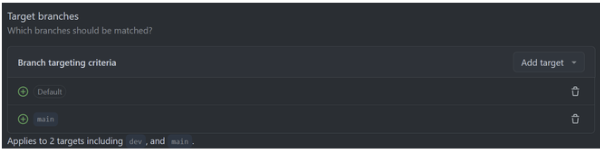
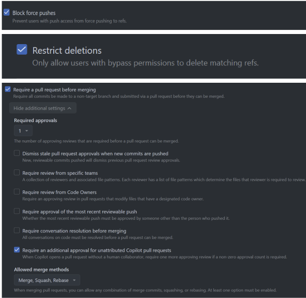

# CONTRIBUTING — Règles de l'équipe

Chaque règle indique le risque qu'elle traite (voir [docs/risques.md](docs/risques.md)).
Cartes du groupe : équipe de 2 développeurs, déploiement continu (plusieurs déploiements par jour).

## 1. Relecture des pull requests

- **1 approbation** par pull request, donnée par l'autre développeur de l'équipe. L'auteur ne peut pas approuver sa propre PR. *(traite R3, R4)*
- Si le relecteur est absent : **on attend sa disponibilité**, on ne force pas la validation, pour ne pas compromettre la production. *(traite R4)*
- Les tests automatiques passent **avant** la relecture : on ne relit pas une PR dont les tests échouent. *(traite R2, R3)*
- Les PR sont petites pour être relues vite et ne pas bloquer l'autre développeur. *(traite R3, R5)*

## 2. Nommage des branches et des commits

- Branches : `dev-<nomdudev>` (ex. `dev-fabien`). *(traite R4)*
- Commits : `[X.Y.Z] message en français` (ex. `[1.2.3] ajout de la route /products`). *(traite R4)*
- Un commit = une seule intention.

## 3. Definition of Done

Une tâche est terminée quand :
1. tous les tests déjà existants passent ;
2. les nouveaux tests couvrant toute la nouvelle fonctionnalité passent ;
3. le déploiement est effectué.

*(traite R2, R4)*

## 4. Versionnage : savoir en 10 secondes quelle version tourne

Format `X.Y.Z`, versions et tags nommés `vX.Y.Z` (ex. `v1.2.23`) :
- `X` : version principale du projet, commune à toute l'équipe ;
- `Y` : feature de la branche en cours ;
- `Z` : correctif (fix) de la branche en cours.

L'image déployée est taguée avec cette version (jamais `latest`) et la version est lisible sur `/health`. *(traite R4)*

## 5. Secrets

- **Où** : dans GitHub Secrets & Variables (chiffrés). Jamais dans le dépôt. *(traite R1)*
- **Qui** : gestion réservée au chef de projet et aux personnes autorisées. *(traite R1)*
- **Fichier `.env`** : jamais public, listé dans `.gitignore`. Seul un exemple avec de fausses valeurs est versionné. *(traite R1)*
- **Si un secret fuite** :
  1. révoquer le secret ;
  2. en générer un nouveau ;
  3. vérifier les logs pour détecter un usage frauduleux de l'ancien ;
  4. faire l'état des lieux de ce qui a pu être compromis ;
  5. agir : base de données → déclaration CNIL ; code du serveur → redéploiement.

## 6. Pourquoi on ne pousse pas sur `main`

`main` est la branche de production. Les fonctionnalités sont développées sur `dev-<nomdudev>` puis arrivent sur `main` uniquement par pull request. *(traite R4)*

## 7. Règles et raisons

| Règle | Raison | Risque |
|---|---|---|
| Sur `main` : suppressions restreintes, push et force-push bloqués | `main` est la prod, les fonctionnalités passent par des branches | R4 |
| Adapter le développement à la capacité de revue | Éviter le ralentissement faute de relecteurs | R3 |
| Ne pas mettre le `.env` en public | Compromission de données importantes | R1 |
| Tester intégralement chaque fonctionnalité avant déploiement | Garder `main` stable et fonctionnel | R2, R4 |

## 8. Ce que GitHub impose et ce qui repose sur la discipline

| Imposé par GitHub (outil) | Repose sur la discipline de l'équipe |
|---|---|
| 1 approbation de PR requise | Format des commits `[X.Y.Z] message` |
| Pas de push direct ni de force-push sur `main`, suppression restreinte | Versionnage `X.Y.Z` |
| Secrets stockés dans GitHub Secrets | Nommage des branches `dev-<nomdudev>` (aucune règle ne le contrôle pour l'instant) |
| `.env` dans `.gitignore` | Respect de la Definition of Done |

Captures de la configuration :

